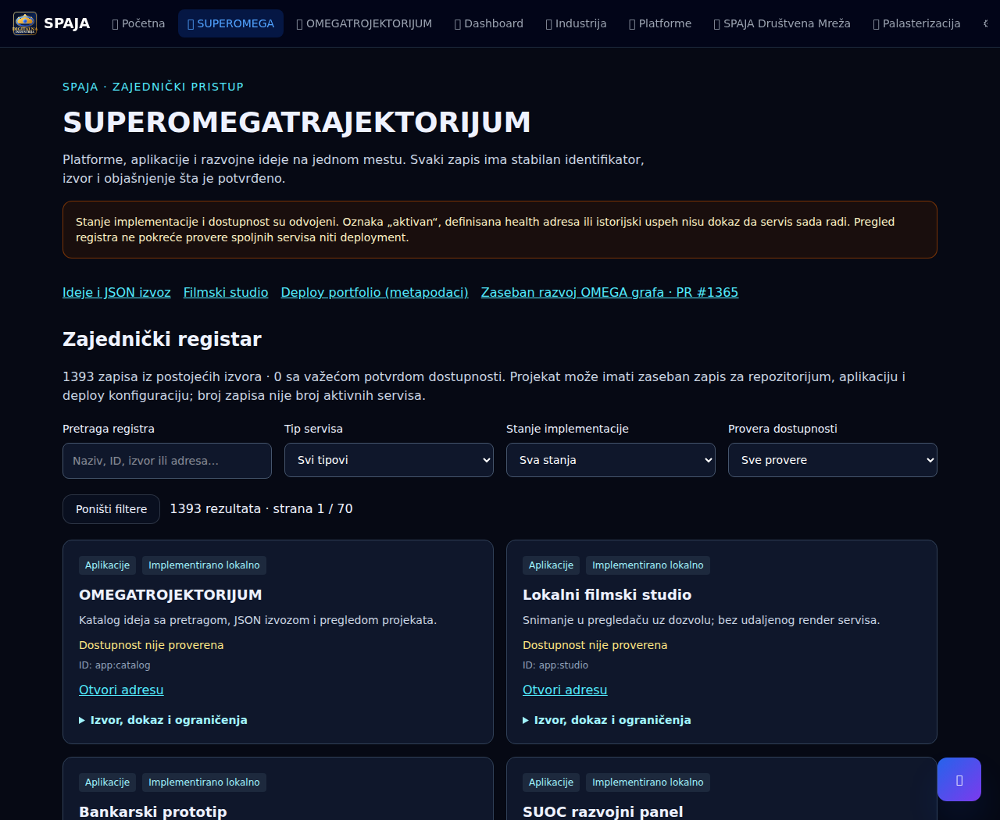

# SUPEROMEGATRAJEKTORIJUM — početni zajednički registar

Razlog promene: zahtev Nikole Spajića od 21. oktobra 2026. za zajednički pristup
SPAJA platformama, aplikacijama, projektima i servisima. Osnova je `main`
`f6c2be5b25d5849193c9067b1f3f5aa67480d4ef`.

## Upotreba i obuhvat

Otvoriti `/superomegatrajektorijum` u lokalnoj Next.js aplikaciji.
Postojeća navigacija i `/omegatrojektorijum` vode na novi pregled. Registar ima
pretragu, kombinovane filtere, reset, paginaciju po 20 zapisa, adresu, izvor,
ograničenja i detalje svakog zapisa. Ideje koriste istu `IdeaCard` komponentu i
postojećih 80 obrazaca; JSON izvoz ostaje u postojećem katalogu.

Postojeća duga desktop navigacija dobija zasebno horizontalno skrolovanje da
novi link i preostale stavke ne prelivaju celu stranicu ili prekrivaju logo.



[Prikaz na mobilnom uređaju](assets/superomega-registry-mobile.png)

| Izvor | Tip zapisa | Broj u početnoj reviziji |
| --- | --- | ---: |
| `src/lib/omegatrojektorijum/catalog.json` | Koncepti | 1325 |
| `src/lib/platforme.ts` | Dokumentovane platforme | 19 |
| `src/lib/omegatrojektorijum-projects.ts` | GitHub repozitorijumi | 7 |
| `src/lib/deploy/deploy-registry.ts` | Deploy metapodaci | 9 |
| `src/lib/suoc-pilot/omega.ts` | OMEGA moduli | 23 |
| Pregledane lokalne rute, lokalni adapter, pilot i navedena Sites adresa | Aplikacije / lokalne funkcije | 9 |
| Korisnikov zahtev za Sites ↔ GitHub razmenu | Plan integracije | 1 |

Ukupno 1393 zapisa. Ovo **nije broj nezavisnih ili aktivnih servisa**. Različiti
aspekti istog projekta (repozitorijum, konfiguracija i aplikacija) ostaju posebni
tipizirani zapisi. Identitet je namespace + izvorni ID, nikad naziv ili indeks
rezultata: `concept:OMEGA-0001`, `repo:spaja86/io-openui-ao`, `deploy:mekartor`.

`buildSuperOmegaRegistry()` koristi postojeće izvoze. Ne kopira kataloge,
ne zahteva token, ne poziva GitHub/hosting API-je i ne pokreće deployment.
Javna projekcija deploy podataka koristi dozvoljeni skup polja; ne prenosi
hook vrednosti, nazive env promenljivih ili provider project ID-jeve.
KPI ciljevi su izdvojeni u zajednički `deploy-portfolio-data.ts`; postojeći
`/api/deploy-portfolio` zadržava isti odgovor.

## Značenje statusa

- `concept`: konceptualna stavka, bez potvrde izvodljivosti ili implementacije.
- `planned`: planirana integracija/modul, bez potvrđenog izvršavanja.
- `documented`: zapis postoji u registru/dokumentaciji; to nije dokaz rada.
- `partial`: delimična implementacija u ograničenom obuhvatu OMEGA pilota.
- `local`: implementacija postoji u pregledanom lokalnom kodu; to nije produkcioni SLA.

Dostupnost je odvojena od ovih stanja. U početnoj reviziji svi zapisi imaju
`availability: null`, odnosno **dostupnost nije proverena**. `aktivan`,
`aktivna`, procenat izgrađenosti, postojanje health adrese, istorijski `success`
i KPI cilj ne proizvode zelen status.

Tip za budući dokaz zahteva tačnu adresu, vremensku oznaku sa zonom, metodu
`http-smoke`, `passed`/`failed`, opis obuhvata i HTTPS referencu na dokaz.
Važenje je najviše 24 sata; stariji rezultat je `stale`, budući ili neispravan
rezultat `unknown`. Sat se osvežava na minut. Provera potvrđuje samo navedeni
obuhvat, ne sve mogućnosti servisa. Budući unos dokaza zahteva pregledan izvor;
ovaj PR ne uvodi API za unos dokaza, probe proizvoljnih adresa ni mrežni skener.

## Granice integracija

SPAJA lokalni Deploy adapter ostaje ograničen na statički testni artefakt,
integritet, lokalnu aktivaciju i rollback. Ne postoji novi build worker.
SPAJA Sites adresa je referenca koju je korisnik naveo; runtime razmena sa ovim
registrom, pristup vlasnika i dostupnost nisu nezavisno potvrđeni.

OMEGA katalog se uvozi iz trenutne grane. Osnova sadrži 23 modula i 25 veza;
zasebni draft [PR #1365](https://github.com/spaja86/AI-IQ-SUPER-PLATFORMA/pull/1365)
razvija 64 odnosa. Cilj 270 ostaje cilj, a ovaj PR ne proširuje graf. `/omega`
pripada lokalnom SUOC pilotu (`http://127.0.0.1:4318/omega`), nije ruta Next.js
aplikacije; klik iz registra vodi na postojeće uputstvo, bez automatskog
pristupa loopback servisu korisnika.

Izvori koda su vezani za pregledanu osnovnu reviziju. Pri sledećem ažuriranju
izvora ponovo pregledati obuhvat i ažurirati `SOURCE_REVISION`; datum prikaza
stranice nije datum health provere. Testovi obuhvataju jedinstvenost ID-jeva,
pokrivenost izvora, lokalne putanje i zabranu promocije konfiguracionog statusa.

## Provera

Node 24, postojeći package-lock bez izmene. Ciljani testovi:

```sh
node --import tsx --test src/tests/lib/superomegatrajektorijum.test.ts src/tests/lib/omegatrojektorijum.test.ts src/tests/lib/omegatrojektorijum-projects.test.ts src/tests/api/deploy-portfolio-evidence.test.ts
npx tsc --noEmit --incremental false
npm run build
```

Browser suite koristi Playwright iz zasebnog test okruženja, bez novih
produkcijskih zavisnosti. Pokrenuti lokalni Next server na portu 3210, pa:

```sh
SUPEROMEGA_PLAYWRIGHT_MODULE=/absolute/path/to/playwright \
node --test src/tests/lib/superomegatrajektorijum-browser.test.mjs
```

Opcioni parametri su `SUPEROMEGA_BASE_URL` (samo loopback),
`SUPEROMEGA_CHROMIUM_EXECUTABLE` i `SUPEROMEGA_CHROMIUM_ARGS` (JSON niz).
Scenariji: kombinovani filteri, paginacija/reset, prazan rezultat, detalji
konfiguracije, postojeće ideje, tastatura, Sites/pilot reference i širine
390/768/1280 px. Spoljni zahtevi u browser testovima su blokirani.

Konačni rezultati i udaljeni CI status navode se u draft PR-u. Lokalni build i
uspeh ciljanih testova nisu potvrda celog repo test/lint/security skupa niti
produkcione spremnosti.

## Uvođenje i povratak

Zadržati zaseban draft do ljudskog pregleda i potrebnih release provera.
Nema promene autentifikacije, infrastrukture, CI konfiguracije, naplate,
tajni, baza ili drugih repozitorijuma. IO-OPENUI-AO ne zahteva izmenu ugovora.
Povratak je revert ovih UI/model promena; nema migracije podataka.
