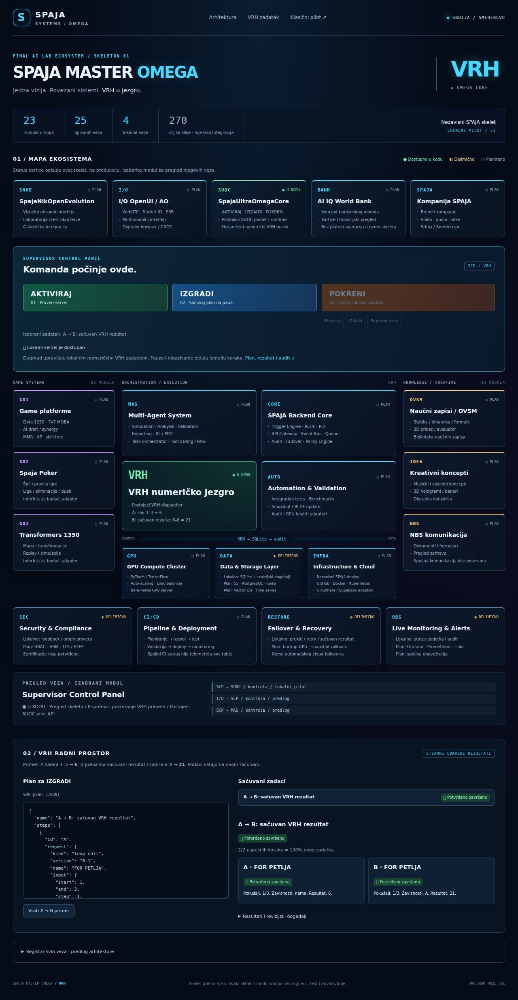

# SPAJA MASTER OMEGA / VRH skelet

Razlog: zahtev korisnika da referentna slika „SPAJA MASTER OMEGA — FINAL AI LAB
ECOSYSTEM“ postane skelet u ovom projektu, sa postojećim VRH jezgrom.

Novi prikaz `/omega` koristi postojeći lokalni SUOC pilot, njegov HTTP ugovor,
radnik, SQLite bazu i numerički VRH dispatcher. Nema drugog izvršnog engine-a.
Otvaranje stranice ili izbor kartice ne pokreće zadatak.



## Pokretanje

Sa Node.js 24 i instaliranim zavisnostima:

```sh
npm ci --ignore-scripts
npm run suoc:pilot
```

Otvoriti `http://127.0.0.1:4318/omega` (ili port ispisan u terminalu).
Klasični pilot ostaje na `/`. Oba prikaza dele iste sačuvane zadatke.

1. **AKTIVIRAJ** proverava servis i osvežava stanje. Nije autentifikacija.
2. Pregledati ili izmeniti JSON u „VRH radnom prostoru“.
3. **IZGRADI** validira i čuva taj plan u pauziranom stanju.
4. **POKRENI** nastavlja trenutno izabrani, prikazani zadatak.
5. Pogledati rezultat i audit. Pauza/otkazivanje deluju između koraka;
   priprema retry-a ostavlja zadatak pauziranim do sledećeg POKRENI.

Podrazumevani primer je postojeći A → B: A sabira 1–3 do 6, B koristi
sačuvani rezultat A kao početak i sabira 6–8 do 21. Imena dugmadi ne
pokreću infrastrukturu, igre, banku, spoljne agente ili deployment.

## Slika → kod

| Sloj slike | Skelet |
| --- | --- |
| SNOE, OpenUI/AO, SUOC, World Bank, Kompanija SPAJA | Gornjih pet kartica |
| Supervisor Control Panel | Funkcionalne kontrole postojećeg pilota |
| Dota / Poker / Transformers | Levi stub; planirani adapteri |
| Multi-Agent, Backend, VRH, Automation | Centralni sloj; lokalni VRH primer |
| OVSM, kreativni koncepti, NBS | Desni stub; planirani adapteri |
| GPU, storage, infrastructure | Temelj; lokalni SQLite, ostalo plan |
| Security, CI/CD, recovery, monitoring | Donji operativni sloj sa preciznim obimom |

Registar sada ima **23 modula i 64 funkcionalno opisana usmerena odnosa**:
**4 implementirana lokalno, 3 delimična i 57 planiranih**. Četiri implementirana
odnosa i dalje opisuju postojeći put SCP → SUOC → VRH → storage → monitoring.
Nije dodat novi izvršni adapter. Broj 270 ostaje razvojni cilj; preostalih
206 odnosa tek treba opravdati i razraditi. Broj opisanih odnosa nije broj
aktivnih integracija niti procenat produkcione spremnosti.

Detalji modela, analiza svih modula, dokazi i uslovi proširenja nalaze se u
[OMEGA-RELATIONSHIPS.md](OMEGA-RELATIONSHIPS.md). Postojeći eksperimentalni
`vrh-skeleton-proposal.ts` ostaje odvojena dry-run validacija bez ovlašćenja
za izvršavanje.

Statusi kartica opisuju **ovu integraciju**, ne kompletan kod drugih delova
repozitorijuma ili zdravlje produkcije. `U KODU` je lokalna implementacija;
`DELIMIČNO` razdvaja lokalne delove od planiranih; `PLAN` nema izvršni adapter
u ovom skeletu. Stvarno stanje zadatka dolazi iz pilota, nezavisno od kataloga.
Uptime, bankarske veze, GPU klaster i sertifikacije sa slike nisu potvrđeni.
Hosting je nezavisan; nije uvedena Vercel zavisnost.

## Mesta za proširenje

- `src/lib/suoc-pilot/omega.ts`: postojeći tipizirani katalog 23 modula, validiran pri učitavanju.
- `src/lib/suoc-pilot/omega-links.ts`: 64 opisana odnosa sa dokazima i kriterijumima.
- `src/lib/suoc-pilot/omega-model.ts`: model, validacija referenci/duplikata i izvedeni brojači.
- `pilot/suoc/omega.html`, `omega.css`, `omega.js`: responzivni prikaz,
  izbor modula, ulazne/izlazne veze, kombinovani filteri i detalji aktiviranja. Tekst se upisuje preko `textContent`.
- `pilot/suoc/pilot.js`: postojeće kontrole, izbor zadatka, status i audit;
  dele ih oba prikaza, bez kopije logike izvršavanja.
- `GET /api/omega`: read-only katalog sa istim lokalnim Host/Origin i
  `X-SUOC-Pilot: 1` proverama kao ostali pilot API pozivi.

Za dodavanje stvarnog adaptera potrebno je definisati njegov ulaz/izlaz i
posebno implementirati i proveriti integraciju. Promena statusa kartice
sama po sebi ne uključuje servis. Ovaj PR ne menja standardne VRH profile,
budžete, ovlašćenja, DB šemu ili ugovor plana.

## Provere

```sh
npm run test:suoc:pilot
npm run test:suoc
node --import tsx --test src/tests/spaja-ultra/pilot-browser.test.mjs
```

Browser skup zahteva odvojeno instaliran Playwright i Chromium, kao u
[pregledu pilota](SUOC-DURABLE-PILOT-REVIEW.md). Nisu dodate npm zavisnosti.
Novi integracioni testovi su u postojećem `pilot.test.ts`, pa ih preuzima
`test:vrh` GitHub workflow. Browser testovi ostaju zasebna lokalna provera.
Obuhvataju mapu, pripremu bez izvršavanja, rezultat 6/21, ponovno učitavanje,
gubitak veze, nedostupan katalog i širine 390/768/1280 px.

Istorijska provera PR-a #1363, pre proširenja odnosa, na osnovi `e201f73a10e25a71c00243dd82fb6bd5751032bd`:
23/23 testova pilota, 73/73 SUOC testova (7 osnovnih + 17 lifecycle + 49 VRH),
9/9 browser testova (7 postojećih + 2 Omega), projektni i strogi pilot
TypeScript, ciljani ESLint i `git diff --check`. Vizuelno pregledan desktop
i mobilni prikaz. Playwright/Chromium su testni alati izvan produkcionih
zavisnosti. Prvi browser pokušaj je bio blokiran nedostajućim Chromium-om;
nakon instalacije zasebnog testnog paketa provera je izvršena. Dva probna
prolaza sa snimanjem ekrana su istekla tokom završnog gašenja servisa;
snimanje je odvojeno od regresionog testa. Standardni browser skup je prošao.
Puni Next.js build, security audit i udaljeni CI nisu potvrđeni ovom lokalnom
proverom. Nema promene Next.js ruta ili produkcionog bundla.

## Uvođenje i povratak

Draft PR → ljudski pregled → lokalno pokretanje. Rollback vraća ove fajlove
nakon zaustavljanja servisa, bez brisanja korisničke baze. Nema migracije,
promene CI konfiguracije ili produkcionog deployment-a. IO-OPENUI-AO nema
downstream promenu; ovo je pregled i lokalna kontrola u istom repozitorijumu.
